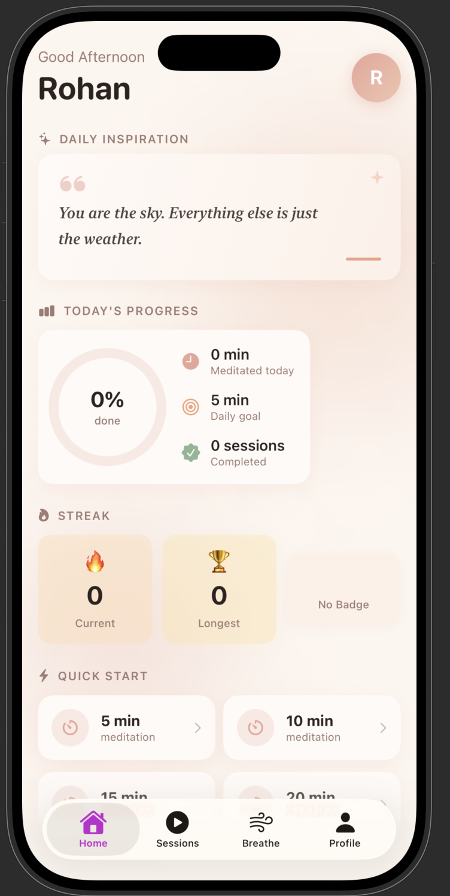
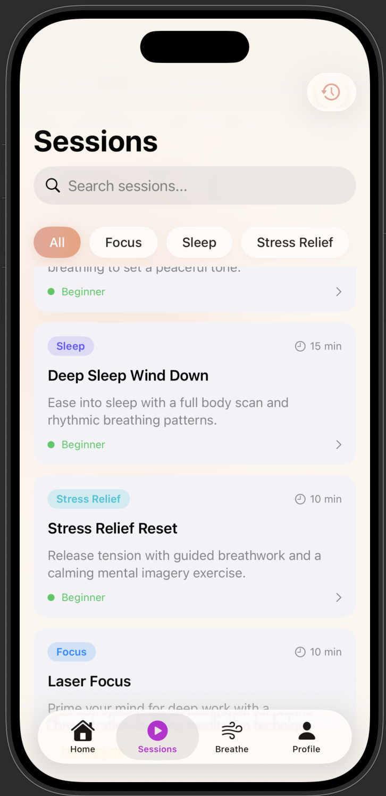
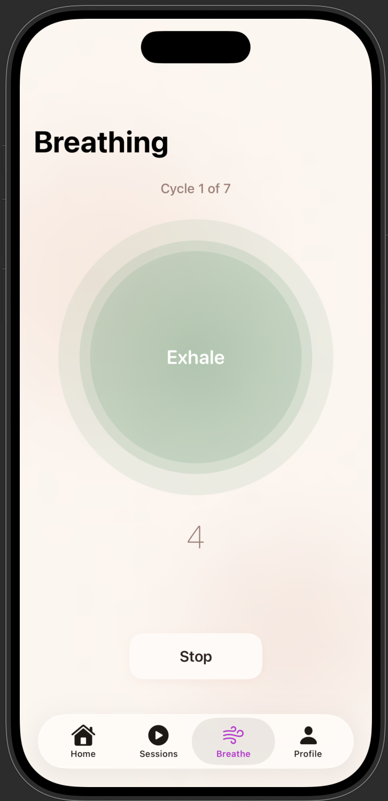
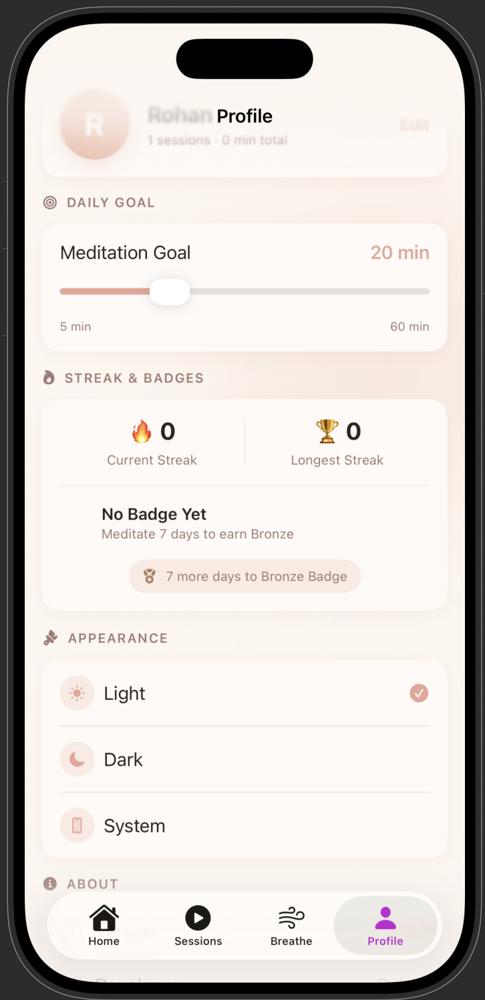

# 🧘 Meditation & Mindfulness App

A clean, calming iOS app built with **SwiftUI** and **MVVM architecture**, designed to help users build a daily meditation habit through guided sessions, breathing exercises, and streak-based motivation.

---

## 📱 Screenshots

<p align="center">
  
  
  
  
</p>

---

## ✨ Features

### 🏠 Home
- Personalized greeting based on time of day
- Daily rotating motivational quote
- Today's meditation progress with an animated progress ring
- Current streak and badge display
- Quick Start meditation timer (5 / 10 / 15 / 20 min presets)

### 🧘 Guided Sessions
- Browse meditation sessions by category — Focus, Sleep, Stress Relief
- Live search across all sessions
- Detailed session view with duration, difficulty, and description
- Built-in meditation timer launched directly from a session

### 🌬 Breathing Exercise
- Animated breathing circle with inhale–hold–exhale guidance
- Configurable number of breathing cycles
- Countdown timer synced to each breathing phase

### ⏱ Meditation Timer
- Start, pause, and reset controls
- Circular progress ring with live time remaining
- Automatic session logging on completion

### 📜 Session History
- Chronological list of all completed sessions
- Total minutes meditated at a glance
- Swipe or tap to delete individual sessions

### 🔥 Streak System
- Daily streak tracking with automatic reset logic
- Longest streak record
- Bronze, Silver, and Gold badge milestones (7 / 15 / 30 days)

### 👤 Profile
- Editable username and daily meditation goal
- Light / Dark / System theme switching
- App information and data reset option

---

## 🛠 Tech Stack

| Layer | Technology |
|---|---|
| UI Framework | SwiftUI |
| Architecture | MVVM |
| State Management | `@StateObject`, `@EnvironmentObject`, `@Published` |
| Persistence | UserDefaults (via a custom `LocalStorageService`) |
| Data Source | Local JSON bundle (mock API layer, swappable for a real backend) |
| Concurrency | Swift `async/await` |
| Animations | SwiftUI native transitions, spring animations, custom breathing animation |

---

## 🏗 Architecture

The project follows a clean **MVVM** structure with clear separation of concerns:

```
MeditationMindfulnessApp
├── App                 → App entry point, environment injection
├── Models              → Codable data models
├── ViewModels           → Business logic & state for each feature
├── Services            → Networking & local persistence
├── Views               → Screen-level SwiftUI views
├── Components          → Reusable UI building blocks
├── Helpers             → Constants, formatters, haptics, theme manager
└── Extensions           → Color and view modifier extensions
```

Each screen has a dedicated ViewModel that owns its state and talks to the `Services` layer, keeping views declarative and free of business logic.

---

## 🎨 Design

The app uses a custom **Blush** color palette — warm cream backgrounds, dusty rose accents, and soft shadows — designed to feel calm and inviting rather than clinical. All major screens support both Light and Dark appearance.

---

## 🚀 Getting Started

1. Clone the repository
   ```bash
   git clone https://github.com/Rk8661/MeditationMindfulnessApp.git
   ```
2. Open `Meditition and mindfulness app.xcodeproj` in Xcode 15+
3. Build and run on iOS 17+ simulator or device

No external dependencies or API keys are required — guided session data is bundled locally as JSON.

---

## 📌 Roadmap

- [ ] Replace local mock JSON with a real meditation content API
- [ ] Add audio playback for guided sessions
- [ ] Push notifications for daily reminders
- [ ] Apple Health integration for mindfulness minutes
- [ ] Widget support for streak tracking

---

## 👨‍💻 Author

**Rohan Kumbhar**
B.Tech, Electronics and Computer Engineering (AI/Data Science)
Ramrao Adik Institute of Technology, Navi Mumbai

---

## 📄 License

This project is open source and available for educational purposes.
